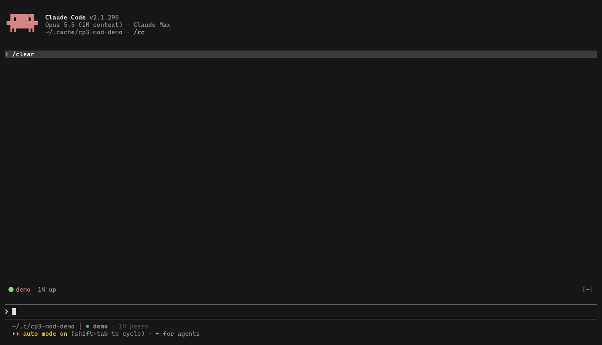

# cp3 mod for Claude Code

A [Claude Code mod](https://code.claude.com/docs/en/plugins/mods/overview) that puts the cp3
peer network inside Claude Code. Needs Claude Code 2.1.290 or later and the `cp3` binary
on PATH (newer than 0.3.0, for `cp3 whoami` and `cp3 subscribe --deliver claude-socket`).



[demo.mp4](demo.mp4) is the same take; `demo.tape` records it with [vhs](https://github.com/charmbracelet/vhs).

What you get:

- **A line above the prompt** — your peer name, how many peers are up (and on how many
  machines), mail waiting. It only says more when something is wrong: not registered, no
  channel, no network. The roster is refreshed in the background, so a slow network never
  stalls the prompt the way the statusline segment can.
- **`/cp3`** — the roster grouped by machine (this one first; no groups when there is only
  one), you first, peers that are down last and faint. One row per peer: presence, name, mail
  waiting, what it is doing (its summary, else its terminal title, else its directory). Click
  a name to address it, type in the field to send, the last mail in sits underneath.
  `/cp3 jim hello` sends without opening the pane.
- **Theme and glyphs.** Every color is a Claude Code theme key (`success`, `warning`, `error`,
  `claude`, `inactive`), so the mod follows your theme. Glyphs are Nerd Font codepoints, named
  in the source by their nerdfonts.com names; without a Nerd Font they show as boxes.
- **Claude's own `SendMessage` and `ListAgents` reach the fleet.** Claude Code's
  cross-session messaging only spans one machine unless both sides go through Anthropic's
  servers with Remote Control. With this mod, `ListAgents` also lists every cp3 peer, and
  `SendMessage` to a cp3 peer's name goes over cp3 — same machine, other machine, or a
  box that is offline right now (cp3 queues it). A cp3 name wins over a same-named local
  session.
- **Inbound mail is a native message.** When the mod owns the inbox (see Identity), its
  subscriber posts each peer message into the session's own cross-session inbox socket, so
  it lands mid-turn between tool calls the way a message from another session does. On a
  box with no cp3 MCP server configured, plain `claude` is a peer and
  `--dangerously-load-development-channels` is not needed. Where `cp3 setup` has wired the
  MCP server, that server still owns delivery and still needs the flag (`cp3 run`) until it
  delivers over the same socket — a pending change, not yet made.

## Identity

When the session also runs the cp3 MCP server (`cp3 run`), that server owns the peer name and
the inbox and the mod only draws and bridges. Without it, the mod owns both: it runs
`cp3 subscribe --deliver claude-socket`, which claims the directory's identity (`.cp3-peer-name`,
`CLAUDE_PEERS_AGENT`, or the directory name) and holds it for the session.

## Install

The cp3 repository is the plugin marketplace; the mod is the plugin named `cp3` in it.

```sh
cp3 setup --mod                                          # the cp3 way: runs the line below
claude plugin install cp3 --marketplace WillyV3/cp3      # Claude Code >= 2.1.292, one step
```

In a session: `/plugin install cp3 --marketplace WillyV3/cp3`. To pin a release instead of
`main`, add the marketplace with a tag first: `claude plugin marketplace add WillyV3/cp3#v0.4.0`,
then `claude plugin install cp3@cp3`. The mod's version is the cp3 release it shipped with;
`claude plugin update cp3@cp3` moves to the latest. Match it with the binary: `cp3 doctor`
prints the binary's version first.

## Develop

```sh
claude --plugin-dir ~/projects/cp3/mod            # one session, hot-reloads on save
claude plugin validate ~/projects/cp3/mod         # what it hooks and calls, without running it
claude plugin test ~/projects/cp3/mod             # 9 tests, no session or network
```

A mod runs with your permissions. `claude plugin validate` lists everything this one does:
it runs `cp3` (whoami, peers, send, subscribe), reads the tool list, draws, and keeps one
subscriber pid in the plugin store.

## Verified 2026-10-10 on Claude Code 2.1.296 (omarchy)

Register with cwd; band and pane render; a message from `keeper` arrived as a native
message in a session started with plain `claude` and in one started with
`--dangerously-skip-permissions` (delivered, not held); Claude replied through the native
`SendMessage` tool and the ACK arrived over cp3; `ListAgents` listed the fleet; a hot
reload replaced the subscriber without leaving a twin name. The sample mods Anthropic ships
(`claude-code-playground/claude-code/mods`) and the built-in `/plugin-authoring` skill were
the references. The exact events and methods for your build are written to
`.claude-plugin/types/` the first time the mod loads; trust those over any doc page.

## Files

```
mod/
├── .claude-plugin/plugin.json   manifest
├── hooks/hooks.json             points at the module
├── hooks/cp3.mjs                the mod (one file; the cp3 binary is the only network code)
├── tests/cp3.test.ts            claude plugin test
└── demo.tape · demo.mp4 · demo.gif   the recording and how it was made
```
